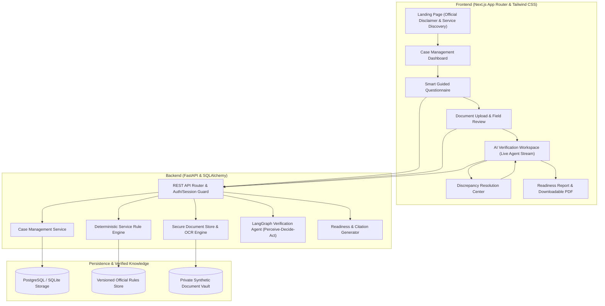
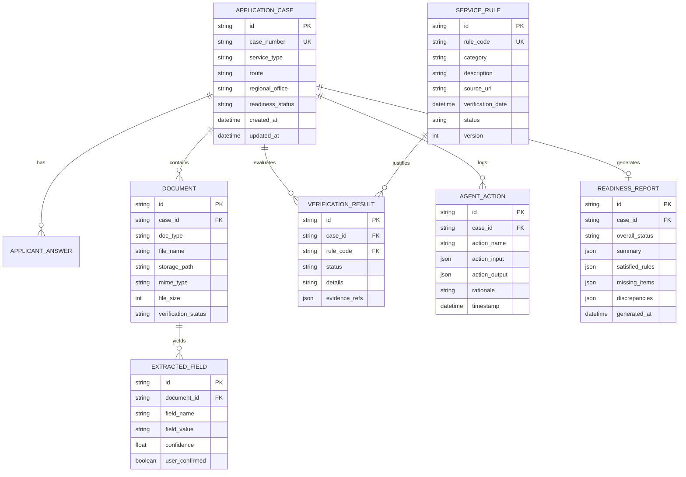

# OneVisit — Architecture Specification & Implementation Plan

## 1. System Architecture Overview

OneVisit is an agentic civic-service preparation platform specifically targeting Sri Lankan passport applicants (Department of Immigration and Emigration — DIE). It bridges the gap between complex government regulations and citizen readiness through deterministic rule enforcement, automated OCR verification, and an iterative AI agent loop.

---

## 2. Core Modules & Responsibilities

### 2.1 Deterministic Rule Engine vs. AI Agent
* **Rule Engine (Zero Hallucination)**: Evaluates strict eligibility constraints (e.g., age thresholds, required documentation for renewal vs. first-time, mandatory regional office documentation). Decides statuses: `SATISFIED`, `MISSING`, `DISCREPANT`, `UNVERIFIED`, `BLOCKED`.
* **LangGraph Agent (Reasoning & Orchestration)**: Navigates the verification graph:
  1. **Perceive**: Inspects case state, uploaded files, and parsed OCR data.
  2. **Decide**: Determines which rule to verify next or whether clarification is needed.
  3. **Act**: Executes specialized tools (`compare_document_fields`, `identify_missing_evidence`, `request_user_clarification`, `update_case_state`).
  4. **Loop**: Re-evaluates until terminal status (`READY`, `NEEDS_CLARIFICATION`, `BLOCKED`) is achieved.

### 2.2 Verified Official Sri Lankan Passport Rules (MVP)
Source: Department of Immigration and Emigration Sri Lanka (`www.immigration.gov.lk`)
* **RULE-LK-PASS-001**: Sri Lankan National Identity Card (NIC) mandatory for all applicants $\ge 16$ years old.
* **RULE-LK-PASS-002**: Certified Original Birth Certificate issued by the Registrar General's Department (or consular birth certificate) required.
* **RULE-LK-PASS-003**: Cross-Document Identity Consistency: Full name, Date of Birth, and NIC number must match across NIC, Birth Certificate, and Application data.
* **RULE-LK-PASS-004**: Previous Passport Holders must surrender previous passport or provide cancellation/lost passport police report.
* **RULE-LK-PASS-005**: Regional Office Jurisdiction (Kandy, Matara, Vavuniya, Kurunegala, Colombo Head Office).
* **RULE-LK-PASS-006**: Biometric Studio Photo Acknowledgement Receipt (ICAO standards).

---

## 3. Database Schema

---

## 4. API Specification Contracts

| Endpoint | Method | Description |
|---|---|---|
| `/api/v1/cases` | `POST` | Create a new application case |
| `/api/v1/cases/{id}` | `GET` | Retrieve case state and progress |
| `/api/v1/cases` | `GET` | List all application cases |
| `/api/v1/cases/{id}/answers` | `PUT` | Update questionnaire responses and route selection |
| `/api/v1/cases/{id}/documents/upload` | `POST` | Upload supporting document (multipart) |
| `/api/v1/cases/{id}/documents/synthetic` | `POST` | Seed synthetic documents for demo scenarios A & B |
| `/api/v1/cases/{id}/documents/{doc_id}/ocr` | `POST` | Trigger OCR and field extraction |
| `/api/v1/cases/{id}/fields/confirm` | `POST` | User review and manual confirmation of OCR fields |
| `/api/v1/cases/{id}/verify` | `POST` | Launch LangGraph Agent verification loop |
| `/api/v1/cases/{id}/verify/stream` | `GET` | Server-Sent Events (SSE) of Agent thoughts & tool actions |
| `/api/v1/cases/{id}/discrepancies/resolve`| `POST` | Submit discrepancy resolution / clarification |
| `/api/v1/cases/{id}/report` | `GET` | Generate and retrieve structured readiness report |
| `/api/v1/cases/{id}/report/pdf` | `GET` | Download printable/official-reference PDF summary |
| `/api/v1/rules` | `GET` | List verified government rules and source links |

---

## 5. Implementation Roadmap & Milestones

1. **Stage 1: Architecture & Foundations**
   - Project structure setup (`backend/`, `frontend/`, `demo/`, `docs/`).
   - Backend FastAPI app with Pydantic v2 schemas, SQLAlchemy models, and verified Sri Lankan passport rules registry.
   - Deterministic rule engine and synthetic document store.

2. **Stage 2: Frontend Design System & Screens**
   - Next.js 14 App Router project with Tailwind CSS and Deep Navy/Blue civic theme.
   - Screen 1: Trustworthy Landing Page with Sri Lankan civic branding and legal disclaimer.
   - Screen 2: Case Dashboard with status cards, empty states, and quick actions.
   - Screen 3: Smart Step-by-Step Questionnaire with conditional branching.
   - Screen 4: Document Upload & Field Review with synthetic quick-load selector for hackathon demo.

3. **Stage 3: Agentic Verification & Discrepancy UI**
   - LangGraph Agent workflow with perceive-decide-act loop and structured tools.
   - Screen 5: AI Verification Workspace with live action ticker, inspected rules, and status tracker.
   - Screen 6: Discrepancy Resolution Center (side-by-side mismatch comparison, one-click resolution).
   - Screen 7: Comprehensive Readiness Report with official citations and PDF export.

4. **Stage 4: Automated Testing & Synthetic Scenarios**
   - Test suite covering: First-time applicant, Previous passport holder, Name discrepancy, Missing documents, Low-confidence OCR, Prompt injection resistance.
   - Synthetic fixtures for Scenario A (Kandy first-time with name discrepancy) and Scenario B (Previous holder missing document).
   - Comprehensive README and demo guide.
